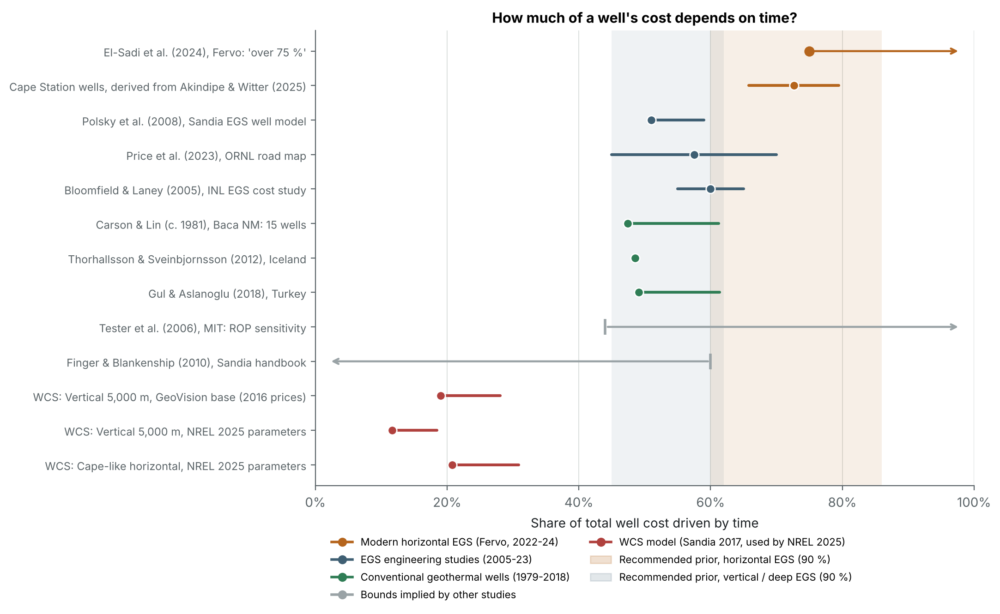
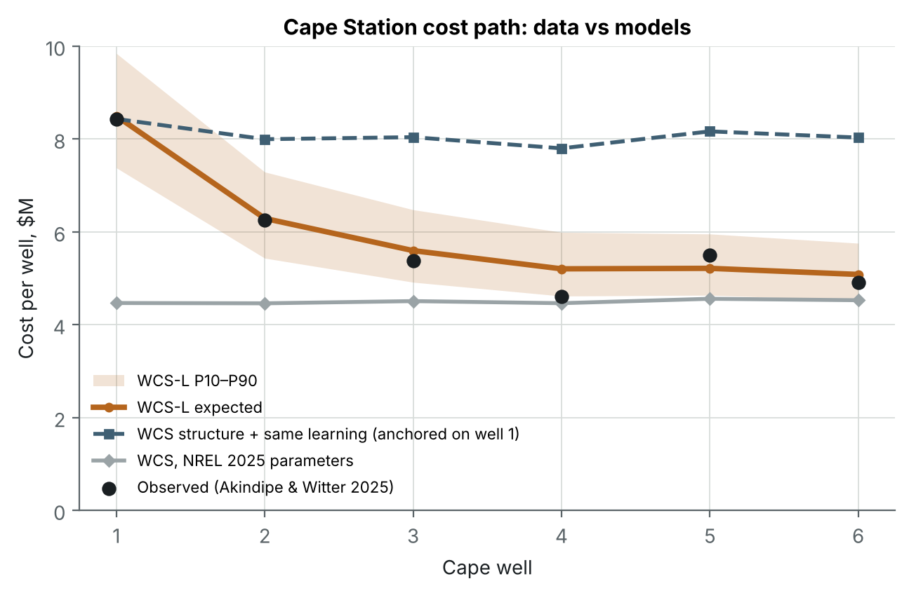

# WCS-L

**A well-cost model for EGS campaigns: the Sandia WCS, rebuilt and extended with learning, an all-in spread rate and random trouble time.**

The Sandia Well Cost Simplified model (WCS; Lowry et al. 2017) underlies the GeoVision and NREL 2025 geothermal drilling cost curves. It prices every well as if it were the first of its kind, and it puts only about 21 % of a modern EGS well's cost on drilling time. Fervo reports over 75 %. Because learning acts on time, the WCS cannot reproduce how fast EGS wells get cheaper: Fervo's six Cape Station wells fell 42 % in cost. WCS-L fixes the cost structure first, then adds learning. It is built for the MIT EGS paper's question: how much does it cost to supply a given number of MW from a campaign of wells?

The repository has three parts:

| Part | Question | Where |
|---|---|---|
| 1. Time-share study | What share of a well's cost is driven by time? | [`docs/01_time_share_study.md`](docs/01_time_share_study.md) |
| 2. The model | WCS engine plus WCS-L: experience, learning per activity, spread rate, trouble time, campaign and pad costs, $ per MW | [`docs/02_model.md`](docs/02_model.md), [`src/wcsl`](src/wcsl) |
| 3. Validation | Is it working, and how do we know? | [`docs/03_validation.md`](docs/03_validation.md) |

## Results in one page

**1. Time drives about three quarters of a modern EGS well's cost; the WCS says a fifth.** Across ten independent sources, conventional geothermal wells sit at 47–49 %, EGS engineering studies at 45–60 %, and Fervo's horizontal wells at 66–86 %. The WCS gives 12–21 %, below every one of them.



**2. With the WCS structure, no learning curve can reproduce Fervo's wells.** Anchored on the first Cape well with the same learning curve, the WCS split predicts the sixth well 5 % cheaper. Observed: 42 %. Calibrated WCS-L reproduces the path within 4.5 % and puts 82 % of the first well's cost on time.



**3. The model is validated as far as six wells allow.**

| Check | Result |
|---|---|
| WCS engine vs Sandia spreadsheets | 249 / 249 workbooks to the dollar |
| NREL 2025 update reproduced | −15.4 % (NREL: about −15 %) |
| In-sample fit, 6 Cape wells | MAPE 4.5 % (WCS: 20 %; "WCS + decay rate": 43 %) |
| One-step-ahead forecasts | MAPE 10.6 %, unbiased; the "WCS + decay rate" model is worst (25.5 %) |
| Uncertainty bands | 5 / 5 out-of-sample wells inside P10–P90; best CRPS of all models |
| Rig time structure vs Utah FORGE 16A | Real well: 44 % flat time; WCS: 15 %. Consistent with the calibrated time scale |
| Project Red → Cape | Learning explains a 14 % fall, observed 60 %: a technology step, modelled separately |

Calibrated values at Cape:
- learning floor at 66 % of the first well's time;
- all-in spread of $157k/day, against the WCS rig rate of $33.5k, with a 31 % premium on the first wells;
- materials at about half of the GeoVision casing design.

## Quick start

```bash
pip install -e ".[dev]"
python -m pytest -q                      # 27 tests, including the 249-workbook reproduction
make reports                             # regenerates every table and figure in reports/
python examples/02_campaign_learning.py  # a 10-well campaign: continuity, pads, rig changes
python examples/03_design_per_mw.py      # method K: choose the design by $ per MW
```

```python
import wcsl
from wcsl import wcs

wcs.well_cost(wcs.cape_like_well())["total"]           # the WCS: $4.57M

cal = wcsl.calibrate(theta=0.75)                        # WCS-L calibrated to Fervo's Cape wells
model = wcsl.WCSL(cal.params)
plans = wcsl.uniform_campaign(10, lambda: wcs.cape_like_well(md_ft=13500), months_between=1, wells_per_pad=4)
model.expected(plans)["mean_cost_per_well"]              # about $5.7M, falling from $8.6M to $4.9M per well
sim = model.simulate(plans, n_draws=5000, uncertainty=cal.uncertainty())
wcsl.percentiles(sim["cost"])                            # P10 / P50 / P90 per well position, for the MILP
```

## Repository map

```
src/wcsl/        the package: wcs.py (engine), model.py (WCS-L), experience, learning, npt, spread,
                 calibration, design (method K), validation
data/            Fervo wells, Utah FORGE 16A time log, time-share evidence, GeoVision test fixture
scripts/         run_time_share_study.py, run_calibration.py, run_validation.py (write reports/)
reports/         generated tables (results.md / .json) and figures
docs/            the three studies, the model description, data notes
examples/        runnable examples
tests/           pytest suite
tools/           extraction of the GeoVision fixture from the original workbooks
```

## Main references

- Lowry, T. S. et al. (2017). [GeoVision analysis supporting task force report: reservoir maintenance and development](https://doi.org/10.2172/1394062). Sandia, SAND2017-9977.
- Akindipe, D. & Witter, E. (2025). 2025 geothermal drilling cost curves update. Stanford Geothermal Workshop.
- El-Sadi, K. et al. (2024). [Review of drilling performance in a horizontal EGS development](https://pangea.stanford.edu/ERE/db/GeoConf/papers/SGW/2024/Elsadi.pdf). Stanford Geothermal Workshop.
- Brett, J. F. & Millheim, K. K. (1986). The drilling performance curve. SPE 15362.
- Kellogg, R. (2011). [Learning by drilling](https://www.nber.org/papers/w15060). Quarterly Journal of Economics.
- Jablonowski, C. et al. (2011). Integrating learning curves in probabilistic well-construction estimates. SPE Drilling & Completion.

The full evidence base for the time-share study is in [`data/time_share/sources.csv`](data/time_share/sources.csv).

## Status and caveats

Version 0.1, built for the MIT EGS paper (submission target 20 December 2026).
- Calibration and validation rest on six Cape wells from one operator. Every procedure re-runs as more wells are published.
- The time-driven share at Cape (θ) is inferred, not observed. The open questions to Fervo, NREL and Sandia are listed in the time-share study.
- The GeoVision fixture comes from files shared by Sandia; see [`docs/data.md`](docs/data.md) before making the repository public.
