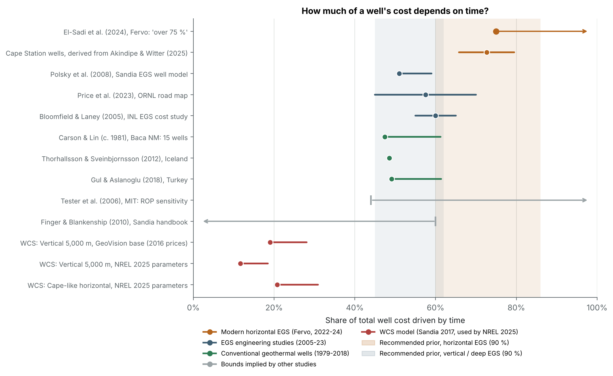

# Study 1 — What share of a well's cost is driven by time?

**Answer.** On modern horizontal EGS wells, about **three quarters** of the cost is driven by time: 0.75 central, with a 90 % range of about 0.60–0.86. On conventional and deep vertical geothermal wells it is about **half**: 0.52 central, 0.45–0.62. The Sandia WCS model, which NREL's 2025 cost curves are built on, puts it at **12–21 %**. That is below every empirical source we found.

*Figure: each row is one source. The dot is the point estimate under the spread definition. The bar runs to the broad definition, or across the stated range. Arrows are one-sided bounds. Shaded bands are the recommended priors. Generated by `scripts/run_time_share_study.py`.*

## Why this number matters

Learning shortens drilling time, so it only reduces the part of the cost that scales with time. With the WCS split (21 %), even a learning curve fitted to Fervo's wells lowers the 6th Cape well's cost by about 5–8 %. With a 75 % split it lowers it by about 25 %. Fervo observed **−42 %**. The time share therefore decides how much drilling more wells can save, and it is the first parameter WCS-L needs.

## Definitions

Studies use different denominators and different notions of "time cost". We put every source on the same footing:

| Term | What it includes |
|---|---|
| **Total well cost** | Everything to deliver the drilled and cased well: rig, services, materials, site and mobilisation. Stimulation and surface plant are excluded. |
| **Spread (time-driven) cost** | Everything billed per unit of time: rig day rate and crew, fuel, water, rentals, day-rate services (directional, MWD, mud engineering), supervision. In activity-based models, also the cost of each time-based activity at the daily rate. |
| **Broad definition** | Spread plus consumables whose quantity follows drilling time: bits and mud materials. |
| **Non-time cost** | Casing and cement (including cementing services priced per job), wellhead, liner hangers, site preparation, mobilisation, logging priced per run. |

WCS-L uses the **spread** definition. In WCS-L, bits are a material whose quantity falls with drilling hours, so counting them as time as well would double-count them. The time share θ in this study is the share of total well cost that WCS-L's spread rate × days must carry.

## Sources

The full dataset is in [`data/time_share/sources.csv`](../data/time_share/sources.csv) (one row per source, with its caveats) and [`components.csv`](../data/time_share/components.csv) (itemised line items, each classed as `time`, `rop_consumable`, `materials`, `fixed`, `other` or `labour_capital`). Shares are computed from the line items, not copied, so every number can be traced.

| Source | Wells | Basis | Spread share | Broad share |
|---|---|---|---|---|
| [Carson & Lin (c. 1981)](https://www.osti.gov/servlets/purl/886096), Sandia | Baca, New Mexico; average of 15 geothermal wells (1979 $) | Itemised actual costs | 47 % | 61 % |
| [Thorhallsson & Sveinbjörnsson (2012)](https://rafhladan.is/bitstream/handle/10802/8531/UNU-GTP-SC-14-22.pdf), UNU-GTP | Iceland; large-diameter reference well to 2,175 m | Itemised averages ("about half of the well cost is related to the time charges") | 49 % | — |
| [Gul & Aslanoglu (2018)](https://pangea.stanford.edu/ERE/pdf/IGAstandard/SGW/2018/Gul.pdf), Stanford Workshop | Turkey; simulated 3,000 m well | Itemised model | 49 % | 61 % (authors' own time-dependent set: 64 %) |
| [Polsky et al. (2008)](https://www.osti.gov/servlets/purl/1219316), Sandia EGS evaluation | Generic deep EGS well | Activity costs at a $58,130/day all-in rate | 51 % | 59 % |
| [Price et al. (2023)](https://info.ornl.gov/sites/publications/Files/Pub196313.pdf), ORNL road map | Generic geothermal base case | Coarse split | 45 % (labour as non-time) | 70 % (labour as time) |
| [Bloomfield & Laney (2005)](https://inldigitallibrary.inl.gov/sites/sti/sti/3310990.pdf), INL | General drilling (for EGS) | Stated: "the remainder of the cost is proportional to the time for drilling" | 60 % (55–65 %) | — |
| [El-Sadi et al. (2024)](https://pangea.stanford.edu/ERE/db/GeoConf/papers/SGW/2024/Elsadi.pdf), Fervo | Fervo's eight horizontal EGS wells | Operator statement: "Drilling time accounts for over 75% of total well cost" | ≥ 75 % | — |
| Cape Station, derived from [Akindipe & Witter (2025)](https://pangea.stanford.edu/ERE/db/IGAstandard/record_detail.php?id=38009), Table 1 | Fervo's six Cape wells | 1 − non-time cost ÷ cost, with non-time cost of $1.2–2.0M per well | 66–79 % for the campaign; 76–86 % on the first well | — |
| [Tester et al. (2006)](https://www1.eere.energy.gov/geothermal/pdfs/egs_chapter_6.pdf), MIT | Modelled 4,000 m EGS well | Bound: an 83 % rise in ROP cut cost 20 %, so the ROP-linked share is ≥ 0.20 / (1 − 1/1.83) | ≥ 44 % | — |
| [Finger & Blankenship (2010)](https://www1.eere.energy.gov/geothermal/pdfs/drillinghandbook.pdf), Sandia handbook | Conventional geothermal | Bound: "casing and cementing can represent more than 40% of total well cost" | ≤ 60 % | — |
| [Lowry et al. (2017)](https://doi.org/10.2172/1394062), WCS model | Vertical 5,000 m (2016 prices / NREL 2025); Cape-like horizontal (NREL 2025) | Computed with `wcsl.wcs` | 19 % / 12 % / 21 % | 28 % / 18 % / 31 % |

The results are regenerated in [`reports/time_share/results.md`](../reports/time_share/results.md) and [`results.json`](../reports/time_share/results.json).

## Synthesis

| Group | Spread share (mean of point estimates) | Range across sources |
|---|---|---|
| Conventional geothermal wells (1979–2018), 3 itemised sources | 48 % | 47–61 % |
| EGS engineering studies (2005–2023), 3 sources | 56 % | 45–70 % |
| Modern horizontal EGS (Fervo, 2022–24), 2 sources | 74 % | 66 % to over 79 % |
| WCS model (2017; NREL 2025 parameters) | 17 % | 12–31 % |

Four observations:

1. **Independent sources agree with each other and not with the WCS.** Three itemised conventional wells, from three countries and four decades, all land at 47–49 %. Three EGS studies land at 45–60 %. The WCS gives 12–21 %, less than half of the lowest independent estimate. The cause is clear from the WCS formulas. Its hourly rate is the rig rate alone ($28.5–38.4k/day). Directional and MWD services, rentals, supervision and the daily services enter only through small fixed terms. Meanwhile casing and cement are priced on a heavy GeoVision casing design (every string to surface, cemented in full).
2. **Modern horizontal EGS sits higher than conventional wells.** Fervo states over 75 %, and the derivation from its own well costs gives 66–79 % over the campaign. Plausible reasons, which we have not yet confirmed:
   - long laterals with an uncemented liner, or none at all (Cape well 4, Fervo's sixth horizontal, was completed barefoot);
   - fewer casing strings per foot drilled;
   - a high all-in daily spread for directional drilling (about $150–200k/day implied, against a $33.5k WCS rig rate).
3. **The 2025 NREL update makes the WCS split worse.** Faster drilling with an unchanged materials design lowers the vertical well's time share from 19 % to 12 %. That is the opposite of what Fervo's data show.
4. **The definition matters, but not enough to close the gap.** Counting bits and mud as time (broad definition) adds 8–14 points everywhere. It moves the WCS to at most 31 %, still far below the independent sources.

## Recommended values for WCS-L

| Use | Central | 90 % range | Prior (Beta) |
|---|---|---|---|
| Modern horizontal EGS (Fervo-like) | **0.75** | 0.60–0.86 | Beta(18.9, 6.3) |
| Vertical or deep EGS wells, conventional geothermal | **0.52** | 0.45–0.62 | Beta(71.6, 66.1) |

At Cape Station, the time share fixes how the average well cost ($5.85M over 24.7 days) splits between the daily spread and non-time cost:

| θ | Implied all-in spread | Non-time cost per well |
|---|---|---|
| 0.50 | $117k/day | $2.92M |
| 0.60 | $140k/day | $2.34M |
| **0.75** | **$175k/day** | **$1.46M** |
| 0.86 | $201k/day | $0.82M |

## Limitations and how to close them

- **Few sources, mixed vintages and bases.** Only three sources itemise actual costs. The EGS studies are models, and the Fervo figure is a single sentence without a definition. The ranges are wide for this reason, and the paper should treat θ as uncertain, not as a fixed number.
- **The Cape derivation depends on the assumed non-time cost.** Fervo has not published its split between materials and time. The $1.2–2.0M range spans a lighter Fervo design to roughly 70 % of the WCS materials.
- **OCR and chart readings.** Carson & Lin's table comes from an OCR scan and Polsky's shares from chart labels. Both are flagged in the dataset.
- **What would settle it:**
  - Fervo's definition behind "over 75 %" (what counts as drilling time and as total cost);
  - NREL's time and materials split for its Cape case;
  - the daily cost reports for the Utah FORGE wells, if DOE can release them.

  These are the questions for the emails to Fervo, NREL and Sandia.

Other sources we read that give no usable split:
- [Khankishiyev & Salehi (2023)](https://arxiv.org/pdf/2402.14824): "the rig, cementing, casing and directional drilling are the top 4 categories consisting of 3/4 of the total well cost".
- [CATF (2025)](https://www.catf.us/wp-content/uploads/2025/08/CATF-EGS-Trend-Analysis-Report.pdf): Fervo wells at $4.6M; "time-dependent costs have the highest impact".
- [DOE Liftoff (2025)](https://www.energy.gov/sites/default/files/2025-07/LIFTOFF_DOE_Next-Generation-Geothermal%20Power.pdf): drilling cost from $9.5M to $4.8M over six wells.
- [Mansure & Blankenship (2013)](https://www.osti.gov/servlets/purl/1078952).
- [Okwiri (2013)](https://rafhladan.is/bitstream/handle/10802/7677/UNU-GTP-2013-25.pdf?sequence=1): time shares, not cost.
