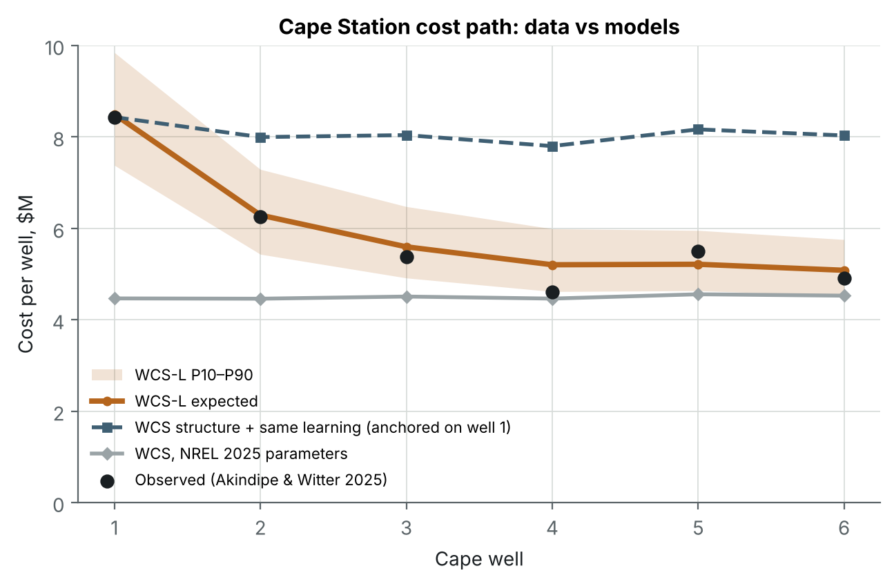
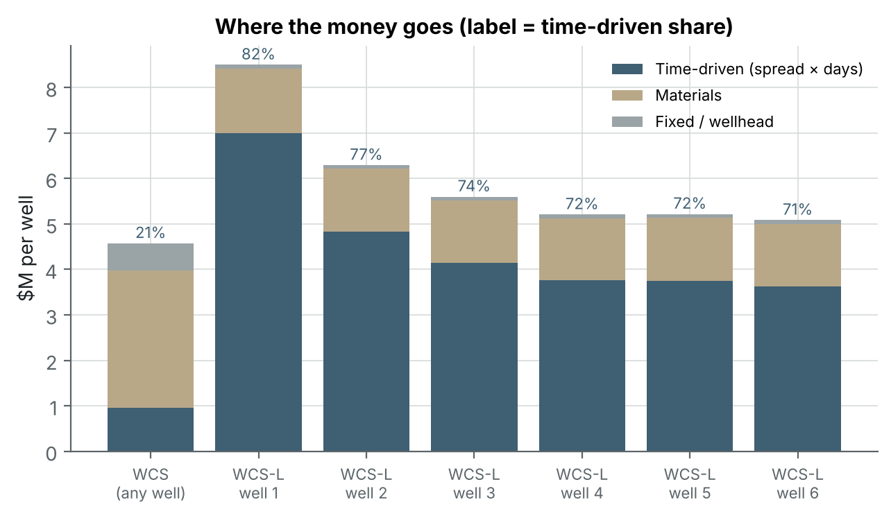
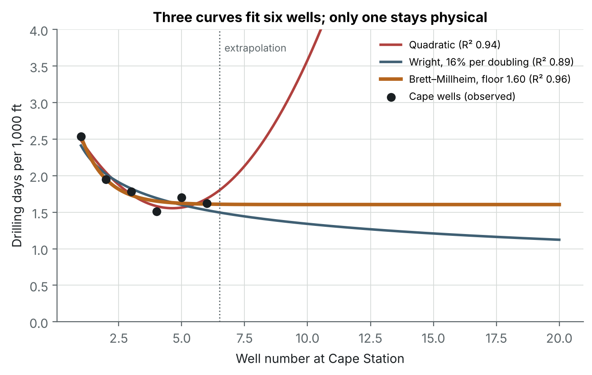

# Study 2 — The WCS-L model

WCS-L keeps the bottom-up logic and geometry of the Sandia WCS and changes four things:

1. Time is priced with an all-in **spread rate**, not the rig rate.
2. Each **activity learns** toward its own floor as **experience** grows.
3. **Trouble time** is random, not a flat contingency.
4. Costs are booked at **campaign, pad and well** level.

A fifth piece links it to the optimiser: each design is judged by its **cost per MW**.

The equations are explained symbol by symbol, with worked examples, in the WCS-L formula guide artifact. This page maps them to the code.

## Architecture

```
            data/fervo, data/forge, data/time_share
                              │
   wcs.py ── WCS engine (validated, 249/249) ── geometry, first-well hours by activity, material quantities
      │
   model.py ── WCS-L: experience → learning per activity → trouble days → spread rate → materials → campaign
      │            ├── experience.py   E_n
      │            ├── learning.py     Brett–Millheim, Wright, quadratic; fits
      │            ├── npt.py          Poisson × lognormal trouble time
      │            └── spread.py       s_n
   calibration.py ── fit to an operator's wells (Fervo Cape by default), using θ from Study 1
   design.py ── method K: $ per MW for a menu of designs (MW from GEOPHIRES)
   validation.py ── metrics, rolling-origin and hold-out procedures, benchmark models
```

## Equations and where they live

| Equation | Code |
|---|---|
| Experience: E_n = 1 + Σ_{m<n} δ^(t_n − t_m) · ω^1[different rig] · γ^1[other project] | `experience.experience` |
| Planned time: T_n^plan = κ · Σ_a H_a^1 · [f_a + (1 − f_a) e^(−k_a (E_n − 1))] | `model.WCSL.expected`, `learning.bm_factor` |
| Trouble: N_n ~ Poisson(λ0 e^(−kλ (E_n − 1))), D_j ~ LogNormal | `npt.NPTModel` |
| Days: T_n = T_n^plan / 24 + Σ D_j | `model.WCSL.expected` / `simulate` |
| Spread: s_n = s∞ (1 + ε e^(−k_s (E_n − 1))) | `spread.SpreadRate` |
| Materials: M_n = μ · [casing · p_steel + cement · p_cem + logging + (bits + BHA) · p_bits · f_drilling(E_n)] | `model._well_static`, `model.WCSL.expected` |
| Well cost: C_n = s_n T_n + M_n + wellhead (+ s_n × skid days if not first on its pad) | `model.WCSL.expected` |
| Campaign: C = F_mob + P · F_site + (P − 1) · move · F_rig + Σ_n C_n | `model.WCSL.campaign_fixed` |
| Design choice: min Σ x_{n,d} C_{n,d} s.t. Σ x_{n,d} MW_d ≥ D | `design.evaluate` (enumeration; the MILP replaces it) |

H_a^1 is the first-well hours of activity a from the WCS engine (drilling, tripping, casing and cementing, logging, flat). κ (`time_scale`) scales the WCS hours to the operator's first well. The WCS has almost no flat time, so κ > 1 (see validation V7). μ (`materials_mult`) scales the WCS material quantities to the operator's design.

## Calibration to Fervo's Cape Station (θ = 0.75)

`wcsl.calibrate()` runs five auditable steps. The results are in [`reports/calibration/calibration.json`](../reports/calibration/calibration.json).

| Step | What it does | Result |
|---|---|---|
| 1. Experience | Monthly drilling, one rig, one project | E = 1.00, 1.93, 2.81, 3.62, 4.38, 5.09 |
| 2. Learning | Subtract expected trouble days, fit Brett–Millheim to planned days per 1,000 ft | τ1 = 2.30, τ∞ = 1.53 (floor 66 %), k = 1.26, R² 0.93 |
| 3. Time scale | Observed first-well planned hours ÷ WCS first-well hours | κ = 1.62 |
| 4. Cost structure | Non-time cost = (1 − θ) × mean cost; WCS materials scaled to match | $1.46M per well; μ = 0.53 (Fervo materials ≈ half the GeoVision design) |
| 5. Spread rate | Fit s∞, ε, k_s to (cost − non-time cost) / days | s∞ = $157k/day, ε = 0.31, k_s = 0.82, R² 0.89 |





The calibrated model puts **82 %** of the first well's cost on time, falling to **71 %** by well 6 as materials become a larger share of a cheaper well. The WCS puts 21 % on time, for every well.

### Learning curve choice



| Curve | R² (6 wells) | AIC | Days per 1,000 ft at well 20 |
|---|---|---|---|
| Brett–Millheim (floor) | 0.96 | −26.2 | 1.60 (stays at the floor) |
| Quadratic | 0.94 | −24.1 | 18.2 (turns back up: not physical) |
| Wright (power law) | 0.89 | −22.5 | 1.12 (keeps falling) |

Brett–Millheim fits best and is the only curve that stays physical when extrapolated. The paper should still show Wright as a sensitivity.

## Default values that are not calibrated

| Parameter | Value | Source |
|---|---|---|
| Forgetting δ | 0.44 per year | Kellogg (2011), QJE |
| Different-rig weight ω | 0.4 | Kellogg (2011): 5.2 %/yr vs 13 %/yr learning |
| Other-project weight γ | 0.5 | Kellogg (2011) |
| Trouble events, first well λ0 | 1.5 | Illustrative; frequencies in Carson & Lin (c. 1981) |
| Trouble decay kλ | 0.3 per unit of experience | Illustrative |
| Trouble duration | Median 1.5 days, σ 0.8 | Illustrative |
| Rig move on a pad | 1 day at the spread rate | Assumption |
| Mobilisation + engineering | $260k per campaign | WCS |
| Site preparation | $250k per pad | WCS |
| Move between pads | 40 % of a $250k mobilisation | Assumption |
| Wellhead | $80k per well | WCS |

## Using the model

```python
import wcsl
from wcsl import wcs

cal = wcsl.calibrate(theta=0.75)                         # Fervo Cape Station
model = wcsl.WCSL(cal.params)
plans = wcsl.uniform_campaign(10, lambda: wcs.cape_like_well(md_ft=13500), months_between=1, wells_per_pad=4)
expected = model.expected(plans)                          # cost, days and time share per well
sim = model.simulate(plans, n_draws=5000, uncertainty=cal.uncertainty())
p10, p50, p90 = wcsl.percentiles(sim["cost"])             # per well, for the MILP
```

The MILP takes the P50 and P90 cost per well position as data, the same way it takes GEOPHIRES profiles. Experience depends on the schedule, so a schedule with pauses or rig changes is evaluated by passing its dates and rigs in the `WellPlan`s (see `examples/02_campaign_learning.py`).
