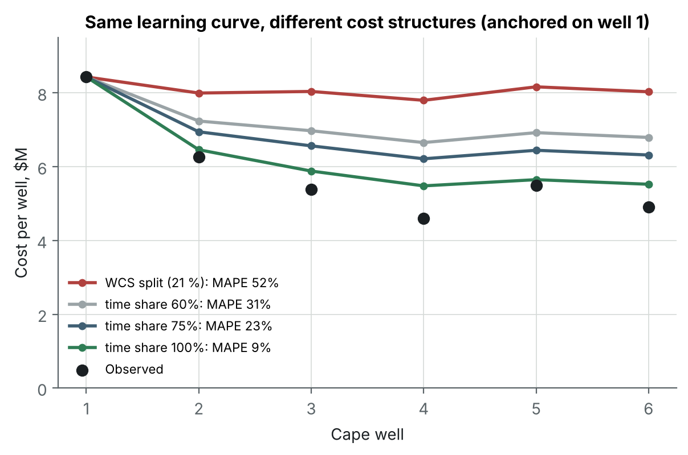
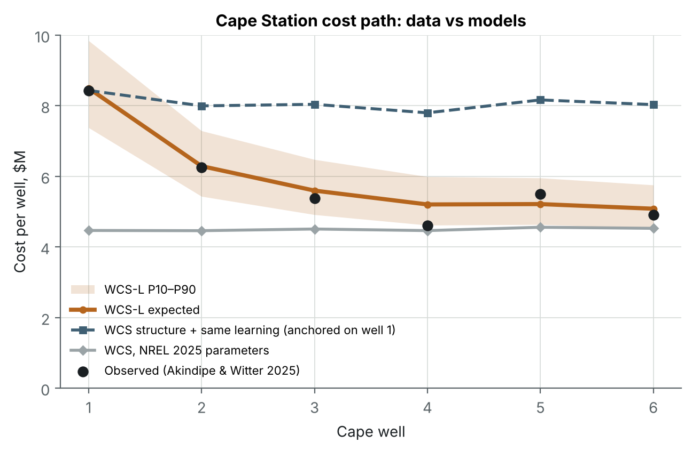
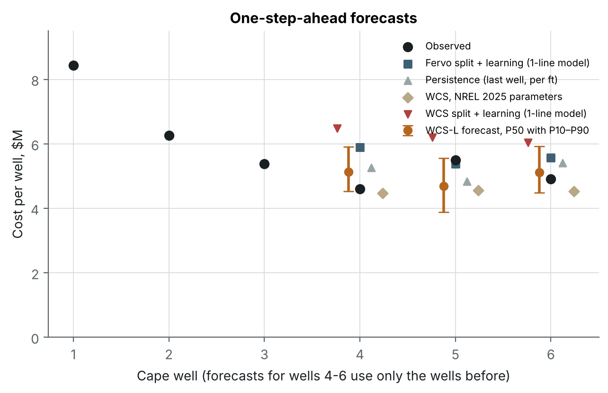
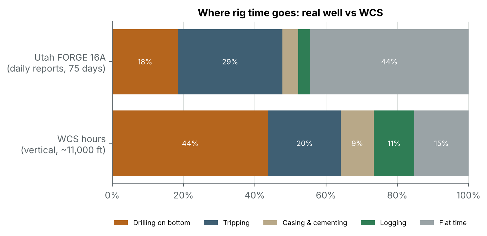

# Study 3 — Is WCS-L working?

**Short answer.**
- The engine reproduces the Sandia model exactly.
- WCS-L reproduces Fervo's cost path, where the WCS structure cannot.
- Out of sample it forecasts as well as the best simple benchmarks, and it is the only model that gives honest uncertainty bands.
- Six wells cannot prove much more than that, and the limits are stated below.

Run `python scripts/run_validation.py`. It writes [`reports/validation/results.md`](../reports/validation/results.md), `results.json` and the figures shown here.

## The eight checks

| # | Question | Result | Verdict |
|---|---|---|---|
| V1 | Does the engine reproduce the Sandia WCS? | 249 of 249 GeoVision workbooks to the dollar; NREL 2025 parameters give −15.4 % on the 5,000 m well (NREL: about −15 %) | Pass |
| V2 | Can the WCS cost structure reproduce Fervo's path? | With the same learning curve, the WCS split (21 %) predicts −5 % by well 6; observed −42 % | WCS fails; the structure is the problem |
| V3 | Does the calibrated model fit the full path? | MAPE 4.5 % on cost and 3.4 % on days; the WCS (NREL 2025) gets 20 % | Pass (in sample) |
| V4 | Does it forecast wells it has not seen? | One-step-ahead MAPE 10.6 %, bias 0 %, comparable to the best benchmarks | Pass, with low power |
| V5 | Are its uncertainty bands honest? | 5/5 forecasts inside P10–P90; best CRPS of all models ($0.33M vs $0.48M or more) | Pass, with low power |
| V6 | Does experience transfer explain the jump from Project Red to Cape? | No: learning explains a 14 % fall; observed 60 % | Needs a technology step (built in) |
| V7 | Does the activity structure match a real well? | FORGE 16A: 44 % flat time; the WCS has 15 % | WCS misses flat time; consistent with κ = 1.62 |
| V8 | How sensitive are the results to θ and spread learning? | Campaign averages are robust; the response to faster drilling scales with θ | Report θ as a range |

## V2 — The structure test

Each line starts at the first Cape well's real cost and applies the **same** learning curve, fitted to the wells' drilling days. Only the time-driven share differs.

| Time-driven share | Predicted change, well 6 vs 1 | Error on wells 2–6 |
|---|---|---|
| 21 % (WCS) | −5 % | 52 % |
| 60 % | −19 % | 31 % |
| 75 % | −25 % | 23 % |
| 100 % | −34 % | 9 % |
| Observed | **−42 %** | |

Even a well that is 100 % time-driven does not reach −42 % from fewer days alone. The rest comes from the cost per day falling (ε, the spread-rate premium of the first wells) and from design changes. Of these, WCS-L models the first and can model the second through `generation_floor` and design options. This test is the core of the paper's argument: **"WCS plus a decay rate" cannot work, because learning acts on time and the WCS puts only 21 % of the cost on time.**

## V3 and V4 — Fit and forecast

Each forecast uses only the wells drilled before the target: wells 1–3 to forecast 4, wells 1–4 to forecast 5, wells 1–5 to forecast 6. The hold-out uses wells 1–4 to forecast wells 5 and 6 together.

| Model | One-step-ahead MAPE, cost | Bias | Hold-out MAPE, cost |
|---|---|---|---|
| **WCS-L** | 10.6 % | 0 % | 13.5 % |
| Fervo split + learning (one-line model) | 14.5 % | +13 % | 3.8 % |
| Persistence (repeat the last well) | 12.2 % | +4 % | 7.6 % |
| WCS, NREL 2025 parameters | 9.3 % | −9 % | 12.4 % |
| WCS split + learning (one-line model) | 25.5 % | +26 % | 18.4 % |

Reading this table honestly:

- **The WCS's good numbers on wells 4–6 are partly in sample.** NREL set its 2025 parameters with these Cape wells in view, and the WCS fits the late wells because they are near the floor. The same WCS misses the first well by 47 % and predicts no learning at all, so it cannot plan a campaign.
- **"WCS plus a decay rate" is the worst model** in every column. It over-predicts by about 26 % because its structure leaves most of the cost untouched by learning.
- **WCS-L, the one-line Fervo-split model and persistence are statistically indistinguishable** on two to three forecasts. Well 5 (Fervo's seventh) is the hardest: it had a larger casing design and 1,500 ft more granite, so its cost rose. No model that does not know about that design change can forecast it. WCS-L is the only model in which a new design can be entered.
- **WCS-L is unbiased one step ahead (0 %).** With four training wells it under-predicts by 13 %, because Cape well 4 (barefoot, the cheapest) pulls the fitted floor down.

## V5 — Probabilistic calibration

All five out-of-sample costs and days fall inside WCS-L's P10–P90 band (nominal 80 %). The probability integral transform values (0.14, 0.89, 0.36, 0.88, 0.78) are spread across the range, with no sign of a band that is systematically too narrow or too wide.

The continuous ranked probability score rewards forecasts that are both accurate and sharp. For a single-number forecast it equals the absolute error, so all the models can be compared on it. WCS-L scores $0.33M, against $0.48M for the next best model (the WCS) and $1.24M for "WCS plus a decay rate".

With five forecasts, 100 % coverage is consistent with a well-calibrated 80 % band: the probability of 5/5 is 0.33. It is not proof. The bands should be re-checked as more wells are published.

## V6 — From Project Red to Cape

Project Red's two wells took 6.33 and 5.17 days per 1,000 ft; the first Cape well took 2.53. Suppose Cape-1 starts about a year after Red, with experience from another project counted at half weight. Then E ≈ 1.4, and learning alone predicts Cape-1 at **86 %** of Red-1's time. Observed: **40 %**. The remaining factor (0.47) is a step in technology, design or geology, which El-Sadi et al. (2024) attribute to new BHA designs, PDC bits and structured trials. In WCS-L this is a lower floor for a new technology generation (`WCSLParams.generation_floor`), not learning. The paper should keep the two apart: learning moves along a curve, and technology moves the curve.

## V7 — Where rig time goes

The Utah FORGE 16A(78)-32 daily reports cover about 1,800 rig hours over 75 days. They show only **18 %** of rig time drilling on bottom and **44 %** flat time: rig-up, circulating, reaming, BOP tests, repairs and coring. A WCS well of similar depth has 44 % drilling and 15 % flat time. The WCS therefore misses roughly a third of the rig hours, which implies a time scale of about 1.4. The calibration at Cape independently finds κ = 1.62. Two different data sets point the same way: real wells spend much more time off bottom than the WCS assumes. This is also why activity-level learning matters. Faster ROP shrinks only the 18 %.

## V8 — Sensitivity

The table is for a 10-well campaign: monthly drilling, 4 wells per pad, 13,500 ft wells.

| Case | Mean cost per well | Well 10 vs well 1 | Well 10 if rig time falls 20 % |
|---|---|---|---|
| θ = 0.60, spread learning fitted | $5.64M | −43 % | −10 % |
| θ = 0.75, spread learning fitted | $5.66M | −43 % | −13 % |
| θ = 0.86, spread learning fitted | $5.67M | −43 % | −16 % |
| θ = 0.75, no spread learning (ε = 0) | $5.75M | −29 % | −14 % |

Once calibrated to an operator's own costs, the campaign averages barely depend on θ: the data pin the path down. θ matters for anything the data have not seen yet:
- the payoff of drilling faster (−10 % to −16 % for 20 % less rig time; the WCS gives about −4 %);
- a new design or deeper wells;
- other operators and prices.

Spread-rate learning (ε) is what makes the path reach −43 %. Without it the model reaches −29 %, so the paper should report ε = 0 as the conservative case.

## Limits

- **Six wells from one operator in one field.** Every out-of-sample statement rests on two to five forecasts. The procedures are in place to re-run as soon as more wells are published, from Fervo's later Cape phases, FORGE or other EGS operators.
- **The non-time cost is not observed.** It is set by θ from Study 1, and the emails to Fervo, NREL and Sandia are meant to pin it down.
- **Trouble-time parameters are illustrative.** The FORGE daily reports and event logs can calibrate them (repair, fishing and waiting hours are already parsed in `data/forge`).
- **The design steps** at Cape wells 4 and 5 are known but not yet entered as separate designs. Entering them is the next refinement.
